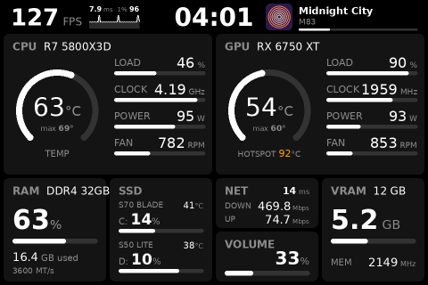
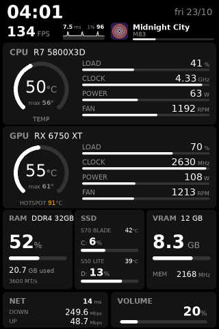
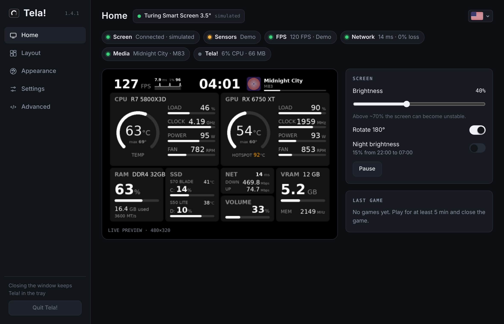
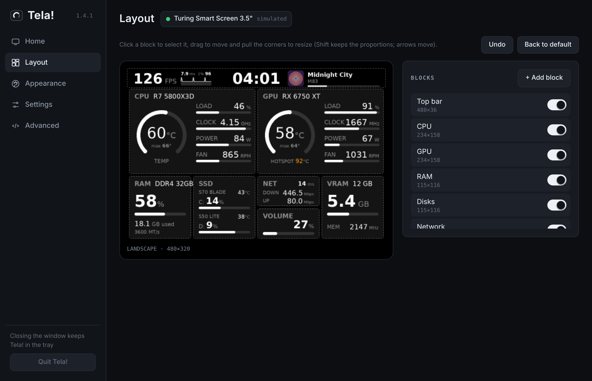
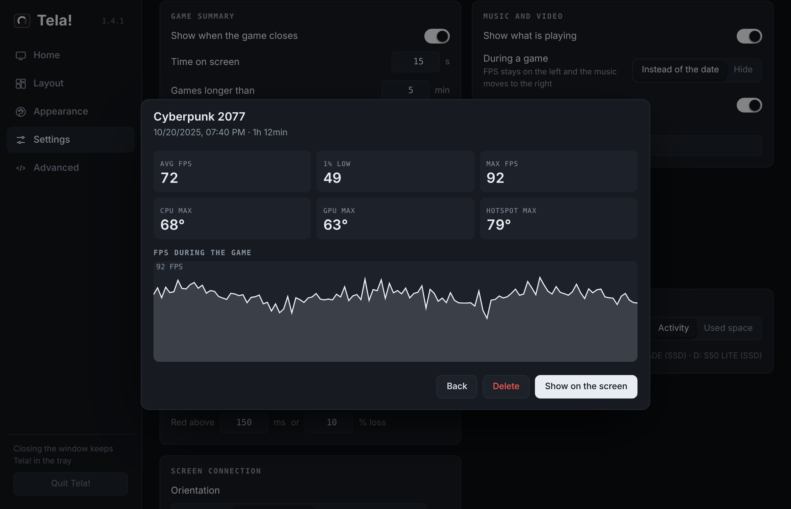

# Tela!

**A free, modern alternative to the official Turing Smart Screen software.**

&nbsp; [All releases](https://github.com/Fekaziroh/Tela/releases) · [Changelog](CHANGELOG.md)

  
  &nbsp;
  

Those small USB screens sold on AliExpress and Amazon come with an app that only shows a few fixed sensors.
Tela! turns the 3.5" model into a real hardware dashboard, in the spirit of the AIDA64 sensor panel:
any sensor your PC has, live FPS from your games, what you are listening to, and a layout you arrange
yourself, all set up from a clean window instead of config files.

- CPU, GPU, RAM, VRAM, disks, network and volume, read by an embedded LibreHardwareMonitor
- **FPS** with frame-time graph and 1% low (PresentMon, or RTSS when it is open)
- **Game summary** when a game closes: average/1% low/max FPS, max temperatures, FPS graph
- **Game history**: every summary is saved; search it, see the FPS graph, export to CSV
- **Music and video** playing (Spotify, YouTube, any app in the Windows media controls) with progress line;
  during a game it moves to the date's place
- Network panel with ping, packet loss and internet outage warning
- **Layout editor**: drag, resize, turn blocks on and off, rename, pick sensors from a live list, add blocks
- Landscape and portrait (and both flipped), screen color themes, background picture
- Window themes (automatic, ready-made or your own colors), Portuguese, English, Spanish and Chinese
- Turns the screen off when the PC locks, the monitor sleeps, the PC sleeps or Tela! closes
- Eco mode when you are away, automatic recovery, diagnostics report
- Updates itself: a button lights up when a new version is out

| Layout editor | Game history |
|---|---|
|  |  |

## Install

Download **[Tela-Setup.exe](https://github.com/Fekaziroh/Tela/releases/latest/download/Tela-Setup.exe)**
(always the latest version) and run it. The setup:

- installs Tela! in *Program Files* with a Start menu shortcut and an entry in *Settings › Apps*
- includes the hardware monitor and PresentMon
- downloads the **PawnIO** driver (CPU and motherboard temperatures) and **Microsoft WebView2** only if
  they are missing
- can start Tela! with Windows (no administrator prompt at logon)

When a new version is out, the version number next to the Tela! name lights up: click it and Tela!
downloads the setup, installs it and opens again. Settings, layouts, themes and the game history are kept
in `%APPDATA%\Tela`.

> Windows SmartScreen may warn the first time because the setup has no paid code-signing certificate:
> click **More info › Run anyway**.

Requirements: Windows 10 or 11 (64-bit), a Turing Smart Screen 3.5" (revision A, USB serial
`USB35INCHIPSV2`). Other Turing sizes are not supported yet.

## Privacy

Everything stays on your PC. Tela! only goes online to ping the servers you configure (for the network
panel) and to ask GitHub whether there is a new version (can be turned off in *Advanced › Updates*); the
setup downloads PawnIO and WebView2 from their official sources when they are missing.

## Building

Every push builds the setup on GitHub Actions (`.github/workflows/release.yml`). When the version in
`engine.py` has no release yet, the workflow publishes one with the notes from `ui/changelog.js`. To build on a Windows PC: install Python 3.13 and Inno Setup 6, then run
`powershell -ExecutionPolicy Bypass -File build.ps1`. Tests: `python tests/run_tests.py`.

Without the setup, `python app.py` runs Tela! from the source folder (`--demo` uses fake data,
`--simulate` draws to `preview.png` instead of the screen).

## License

MIT. See [THIRD-PARTY-NOTICES.md](THIRD-PARTY-NOTICES.md) for the projects Tela! uses.
